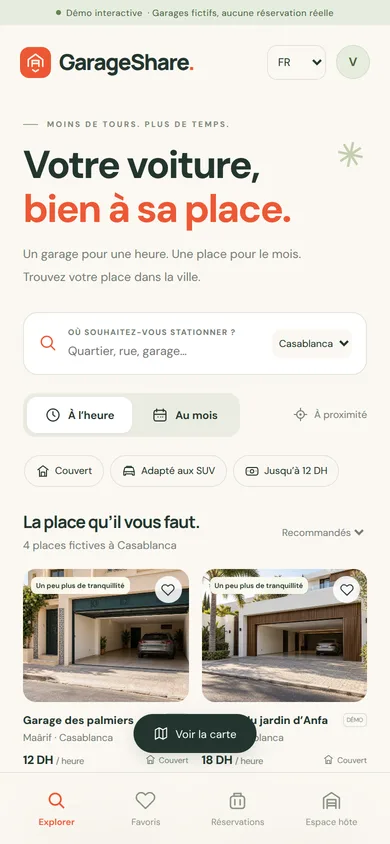
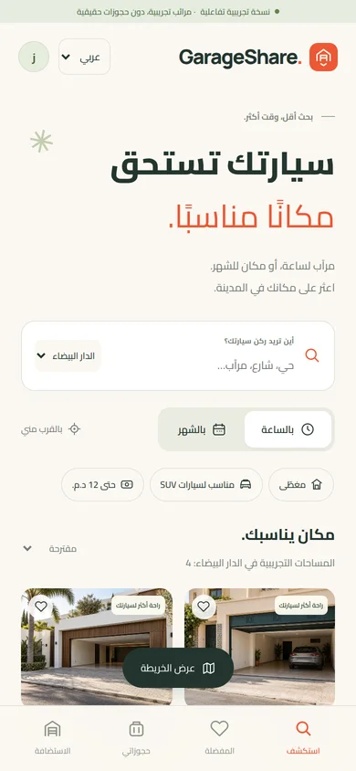

# GarageShare

**GarageShare — garages à l’heure et au mois / مرائب بالساعة وبالشهر**

Languages: **Français · العربية (RTL) · English**. Choose a language in the header or account menu; your preference is saved. Dates, prices, status labels, validation, and privacy text follow that choice. User-written listing content is preserved.




An original Android garage marketplace for Morocco, rebuilt from the GarageShare brief. GarageShare combines photo-led discovery, nearby map prices, hourly and calendar-month bookings, and optional price offers. The logo and interface are original.

## Try it

Install `dist/GarageShare-preview.apk` on Android 8 or newer with an up-to-date Android System WebView. Android will ask you to allow installation from the app opening the APK. This is a development-signed preview, not a Play Store release.

Preview **0.4.0** adds private renter–host chat from offers and bookings, with a Messages inbox, quick replies and read receipts. The APK can update the previous GarageShare preview while keeping its saved data.

The APK bundles the interface, fonts (including Cairo for Arabic), and fictional garage images. Use the header language selector for **Français**, **العربية** (RTL), or English. The choice is saved on the device. It works without an account or server. Map tiles require internet. All bookings, offers, host responses, and approvals in this preview are simulations stored only on the device. Nothing is paid or reserved in real life.

Try these flows:

1. Explore Casablanca, switch between **Hourly** and **Monthly**, and save a garage.
2. Open a garage → choose dates → confirm a preview booking → open **Trips**.
3. Choose **Propose a price** → open Trips → **Preview host reply** → accept the new total.
4. Open **Host** → submit a garage with an entrance pin → preview its approval.
5. In Host → **Reservations & offers** → **Try a sample host request**, then accept or counter it.
6. Tap the account icon → reset the preview when finished.
7. Choose **Request prices** in Explore, select garages, and send a total. In Trips, try sample host replies and choose a quote to confirm one booking.
8. Open **Support** from the account menu or a booking. Create a sample ticket and try a support reply.
9. In **Trips**, choose **Message host** on a replied offer or booking, send a message and tap **Try a sample reply**. Reopen it from **Messages**.

## Run on your computer

Requires Node.js 24 or newer. There are no third-party backend packages to install.

```bash
npm run demo
```

Open `http://localhost:3000`. On Windows PowerShell use:

```powershell
$env:GARAGESHARE_DEMO="1"
node server/index.mjs
```

To run a real local installation with an empty database:

```bash
npm start
```

Make sure `GARAGESHARE_DEMO` is unset. Create two accounts in separate browser profiles: one can host and the other can rent. Every account supports both roles. New host listings stay pending until a moderator approves them using the server CLI. No sample accounts or passwords are added to the live database.

## What is included

| Area | Implemented |
| --- | --- |
| Android | Java Activity with a restricted WebView, bundled preview, native back handling and optional coarse location permission |
| Discovery | Seven Moroccan cities, neighbourhood search, hourly/monthly prices, filters, sorting, saved spaces, OpenStreetMap/Leaflet map |
| Reservations | Server-calculated integer prices, calendar-month dates in Africa/Casablanca, conflict prevention, idempotent creation, free cancellation before the start |
| Negotiation | Guest offers, host acceptance or counter, guest acceptance, expiry, availability recheck on acceptance |
| Competing quotes | One hourly or monthly request sent to up to five garages, host replies and counters, price comparison and one final selection |
| Private chat | Conversation per quote or booking, automatic updates while open, unread counts, quick messages and read receipts |
| Hosting | Same-account host dashboard, entrance pin, dimensions, two prices, pending listings, reservation and offer management |
| Support | Private tickets linked to a booking, customer and staff replies, status filters, staff assignment and resolution at `/admin.html` |
| Moderation | Server-only CLI, accurate-photo requirement before approval, rejection and archival guards |
| Backend | Node.js 24, SQLite WAL, parameterized statements, private sessions, rate limits, audit trail |
| Brand | Editable SVG logo, Android adaptive icon, colours and typography notes |

Payment is **pay on arrival**. GarageShare collects no card details and has no payment gateway in this build. The platform fee is zero in this MVP.

## Source layout

```text
android/    Android Studio / Gradle project
web/        Mobile-first interface, maps, demo repository, local assets
server/     HTTP API, database, moderation CLI
test/       Booking and security integration checks
scripts/    Android asset sync and standalone preview builder
docs/       Deployment, security, product scope and image credits
brand/      Editable logo and visual identity
dist/       Installable preview and screen previews
```

This uses a native Android container with a web interface. It is not a Jetpack Compose implementation. The live app loads the same interface from your configured HTTPS backend so sessions remain same-origin. The offline preview uses only bundled assets and sample data.

## Build in Android Studio

Open the `android` folder. Install SDK Platform 36 and Build Tools 36.0.0; use JDK 17 and Gradle 8.13. Gradle automatically syncs web assets before building. You can also sync them manually:

```bash
npm run android:assets
cd android
./gradlew assembleDebug
```

On Windows, use `gradlew.bat assembleDebug`. With no `serverUrl`, the debug build is the offline preview.

For a live build, first deploy the backend, then use:

```bash
./gradlew assembleDebug -PserverUrl=https://YOUR_DEPLOYED_DOMAIN
```

Only HTTPS origins are accepted. Configure your own release signing in Android Studio using **Generate Signed Bundle / APK** and provide the same `serverUrl` Gradle property. Release builds fail if the server URL is missing. Never distribute the preview development key as your release key.

If Gradle dependency access is unavailable, `bash scripts/build-preview.sh` can build the preview using a locally installed JDK and the Android SDK tools without downloading Android libraries. It needs `ANDROID_HOME`, Python 3, and Node 24. The source does not depend on AndroidX or Capacitor.

## Validation and limits

Run `npm test`. The suite checks time billing, concurrent overlaps, authoritative prices, idempotency, authorization, offer transitions, CSRF/origins, entrance privacy, database overlap triggers, and session revocation. See `docs/VALIDATION.md` for results from this delivery.

The preview is ready for phone testing. A public launch still needs an HTTPS deployment, real listings and photos, a support operator, email verification and recovery, account deletion, final privacy and rental terms, and a signed release bundle. The current payment model is pay on arrival. Follow the staff setup and release steps in `docs/DEPLOYMENT.md` before opening the service to customers.

The original uploaded ZIP is unchanged. Its `.env`, credentials, database contents, PHP code, and payment configuration are not included in this app. Bundled sample garage art, fonts, and Leaflet are reused with their credits. Existing GarageShare accounts/bookings are not migrated; this backend starts with a separate schema.
