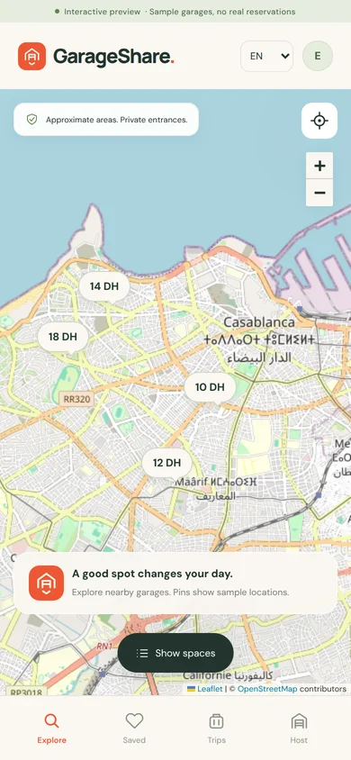

# Validation for this delivery

## Backend

`npm test` completed with **47 passing checks** and zero failures. Coverage includes HTTPS and session security, moderation, private entrances, pricing, concurrent bookings, quote expiry, chat, staff access, calendar blocks and reviews. The new checks cover entrance access for confirmed renters, removal after cancellation or completion and construction of the Google Maps driving URL.

These are local integration tests using a temporary SQLite database and real HTTP requests. Test identities use example.com addresses and no email is sent. They are not a penetration test or a production load test.

## Interface

The optional `node scripts/check-ui.cjs` browser workflow completed **18 checks**, with no uncaught browser errors. It exercised mobile discovery, map price pins, visible OpenStreetMap tiles, saving, monthly prices, details, booking forms, negotiation, confirmation, conflict errors, cancellation, host entrance selection, pending listings, escaped markup, preview approval, host counter offers and horizontal overflow at 320 px and 390 px.

The isolated browser runner could not fetch external map tiles directly. For the successful tile-rendering check, `QA_TILE_RELAY=1` fetched the exact visible OpenStreetMap PNG requests through curl and fulfilled them to the browser. The application itself contains no tile relay or certificate bypass. A separate run verified the map's network-failure message and the continuing availability of list search. Screenshots are browser renders, not physical-device captures.

To reproduce with a normal browser environment:

```bash
npm install --no-save playwright
npx playwright install chromium
node scripts/check-ui.cjs
```

CI may pass `BROWSER_EXECUTABLE` for an installed Chromium. `BROWSER_SINGLE_PROCESS=1`, `BROWSER_PROXY`, and `QA_TILE_RELAY=1` are optional runner workarounds. Production dependencies do not require Playwright.

## Android package

The 0.6.0 preview (version code 7) was compiled from the Java source and bundled web assets with Android SDK Platform 36, Build Tools 36.0.0, Eclipse Java compiler and D8. Zip alignment, APK signature schemes v2 and v3, and the bundled web files were verified. Package metadata confirms `ma.garageshare.app.preview`, minimum API 26, target API 36, INTERNET and optional coarse-location permissions, and the MainActivity launcher. The signing certificate matches the 0.5.0 preview, allowing an in-place update.

The normal Gradle project and wrapper are included for Android Studio. The build runner could not resolve the Gradle Android plugin over its network, so the delivered APK used the included standalone SDK build path. No Gradle build success is claimed.

**Not tested here:** installation or runtime on a physical Android device, native permission dialogs, device-specific keyboard/insets, the Play Store release process, a deployed HTTPS service, real property data, external host handover, or payment processing. Real-device and live-environment testing remain necessary.

## GarageShare 0.2.0 localization

The complete English smoke workflow still passed 18 checks. `node scripts/check-locales.cjs` passed 31 checks for French and Arabic: persistent language choice, RTL/LTR, mobile overflow, translated sample listings, monthly bookings, language changes preserving data, cancellations, host forms, validation messages, privacy and map guidance. No browser errors were observed. `npm test` passed 21 checks including complete translation catalogs and localized HTTP errors.

## GarageShare 0.2.1 map and headline repair

The mobile map now occupies the space between the real header and navigation in a flex layout. Its return-to-list button belongs to the map surface and remains above the bottom navigation. The map uses the visible viewport height and updates Leaflet's size while retaining its center. Entering the map hides the list and restores its scroll position on return. The discovery headline uses upright DM Sans for English/French and retains Cairo for Arabic.

The Android container already applies system-bar padding. It now forwards zero system-bar and cutout insets to WebView while retaining keyboard inset updates, avoiding a second application of the same padding. This follows Android's [WebView inset guidance](https://developer.android.com/develop/ui/views/layout/webapps/understand-window-insets).

`node scripts/check-map-layout.cjs` passed **39 checks**, with no browser errors. At 360 px width it checks English, French and Arabic: the complete return button is visible and receives touches, nearby price pins remain inside the map, the map fills the available area, navigation reaches the visible viewport bottom, and opening the map does not expose the scrolled list. It also checks a simulated visual-viewport reduction from 800 to 650 px, a 480 px tall screen, desktop resizing, retained input focus and restored list scroll. Tile requests are deliberately blocked in this geometry suite; the separate 18-check workflow verified real tile rendering. The 31 localization checks also passed again.

The geometry tests emulate WebView viewport changes in Chromium. The native inset adjustment compiled successfully but still needs confirmation on the user's physical phone.



## GarageShare 0.3.0 quotes and support

`node scripts/check-services.cjs` passed **17 browser checks**. On a local live server, a renter sent a monthly price request to two garages, one host matched it, another countered, and the renter confirmed one reservation at the chosen price. The renter opened a ticket from that booking. A staff account assigned, answered and resolved it, and the renter's reply reopened it. The workflow checked escaped message text, ordinary-account access denial and Arabic dashboard layout at 320 px. The preview run exercised sample host replies, a saved booking, a support conversation and a host's reply to a sample request.

The 18-check interface workflow, 31 localization checks and 39 map layout checks also passed on this version. Browser tests used local fixture accounts and sample data. Physical phone testing and a production deployment are still needed before a public release.

## GarageShare 0.4.0 private chat

`node scripts/check-services.cjs` passed **25 browser checks**. The new workflow sent a message from a quote, received a host reply while the renter kept typing, checked the host's unread count, confirmed a read receipt and opened the same history from the confirmed booking. The preview exercised quick messages and a sample reply. The compact 320 × 520 Arabic layout kept the Send button reachable. The interface, localization and map layout suites also passed on 0.4.0. The browser checks used test accounts and the APK was verified as an installable preview package. Physical phone testing remains pending.

## GarageShare 0.5.0 calendar and reviews

`node scripts/check-services.cjs` passed **36 browser checks**. The host blocked time in the calendar. The renter's date search omitted that garage and carried the chosen start and duration into the booking form. The first review stayed private, the second revealed both, and the listing displayed the published renter feedback as plain text. The preview exercised calendar blocking, unblocking and sample reviews. The Arabic calendar fit a 320 px viewport. The interface, localization and map layout suites also passed. Physical phone testing remains pending.

## GarageShare 0.6.0 map and arrival

The booking workflow passed **43 browser checks**. It verified the exact entrance address and driving URL, the map tile failure fallback at 320 × 520, the labelled sample destination, and the return of focus when a sheet closes. Near me preserved selected dates when changing cities. The map layout passed **43 checks**, including the inline map control and the empty map message. The 18 smoke checks and 31 localization checks also passed. Google Maps navigation on a physical phone remains untested.
